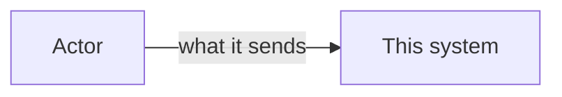

## Actors

*An actor is a person, a role or an external system that uses this system. For each one, say what it needs and what it gives. Say what breaks for it when this system is not there. Name the teams in each role today.*

### [Actor]

Teams in this role today: 

## External systems

*List each system that this system uses or connects to. Say what it gives, and if it is a hard dependency, under evaluation, or deployed but not used.*

### [External system]

## Context diagram

*Draw the system as a box, with the actors and the external systems around it. Label each arrow with what moves. A rough diagram is better than a paragraph. Kairos draws a mermaid block.*

## Key interactions

*Write one row for each arrow of the diagram.*

| Actor or system | Capability area | Interaction |
|---|---|---|
|  |  |  |
