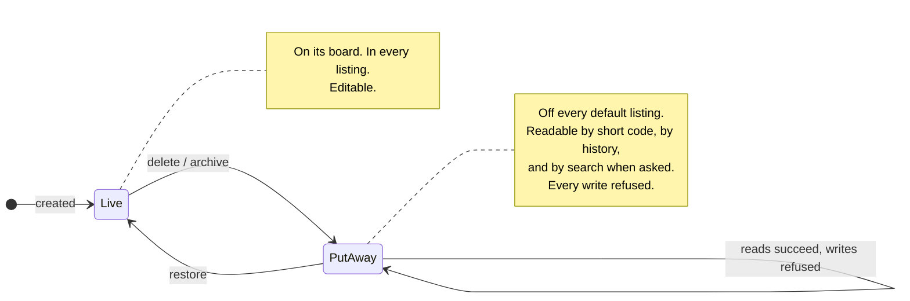

Kairos has one answer to what archiving means, and it is deliberately a small
one:

> **Archived means: this is old, so it is hidden by default. Nothing more.**

Everything on this page is a consequence of that sentence, including several
behaviours that look like bugs until you have read it.

The decision is recent, and it was made because the product had never actually
answered the question. There was one soft delete, stamping a timestamp on the
row. Two different words were used for it — "delete" on the surfaces, "archive"
in the rule that a team may be wound down once its board holds no live cards —
and nobody had said which one the product meant.

## What it replaced, and why that was worse than it sounded

A walk through the product looking for the answer found that archiving behaved
like destruction. Fetching an archived item by short code returned a 404. So
did its version history. The rows were still in the database and nothing served
them, which is a distinction visible only to somebody reading the schema: to
every caller the behaviour was indistinguishable from a hard delete.

The item's custom field values were unreachable in the same way — and yet still
counted by the guard that refuses to retire a field definition while anything
uses it. One archived card could therefore make a custom field permanently
unretirable, with no route to the card that held it. That is not a small bug;
it is a trap, and the only reason it existed was that nobody had decided what
the state meant.

What survived was the activity trail, which records *that* work existed and who
touched it, and never what it said.

So the old behaviour destroyed the audit answer while keeping the audit
question. The point of a system of record is that the record outlives the work,
and an organisation asks "what did that ticket say?" precisely about work that
is finished — which is exactly the work that gets archived. Version history
makes this sharpest: the whole reason Kairos keeps copy-forward history is to
reconstruct what a record said at a point in time, and it went dark at the
moment that mattered.

## The six things the sentence commits to

Read as rules rather than as prose, the decision says:

1. **Archived content stays retrievable**, marked as archived, along with its
   history.
2. **It stays searchable** when asked for explicitly.
3. **Default listings hide it** — boards, queues, directories, ordinary
   search. This is the entire user-visible purpose of the state.
4. **It is not a [permission boundary](../capabilities-and-access/).** Whoever
   could read the work before can read it after.
5. **It is not live work.** Guards that ask "is there still work here?" go on
   counting live rows only.
6. **It is still content.** A guard that asks "does anything still refer to
   this?" may legitimately count an archived carrier — which rule 1 is what
   makes honest, because the carrier can be found.

The numbering is this page's, and it is the numbering the endpoint reference
cites when it says "rule 2" or "rule 3" — follow one of those citations and
you land here, on the argument, which is what you wanted. It matches
the decision record (KAIROS-A-0020),
where the decision was first written down.

"Marked" carries more weight than it looks. Archived rows are marked, never
disguised: anything that serves one says so, through the `archived_at`
timestamp in the payload, a marker in the rendered text an agent sees, and a
banner in the interface. An auditor must never mistake archived work for live
work, which is a different failure from hiding it. The
[schema reference](../../reference/rest/schemas/) is where that marker and the
opt-in that asks for archived rows are specified; what matters here is that
neither is a privilege — they are questions anyone may ask.

The last two look contradictory and are not. They are the two halves of the
distinction this page exists to draw, and the clearest formulation of it is:

> **Containment is a fact about the record; progress is a fact about live work.**

An item's relationship list names its archived children, because what this
initiative contained is a historical fact and omitting rows would make the
record wrong. An archived item does not block anything, because archived work
cannot be waiting on anyone. Same rows, two questions, two honest answers. The
progress rollup is a third question, about finished work. The section
[what archive does to the numbers](#what-archive-does-to-the-numbers) gives its
answer.

That is also why the guards that ask "is there still work here?" — winding down
a [team](../teams-and-boards/), retiring a
[repository](../repositories-as-execution-scope/), removing a board column — go
on counting live rows only. Putting a board's cards away is still how a team is
wound down, and that rule is unchanged by any of this.

The counterweight is the sixth rule. A guard that asks a different question —
"does anything still refer to this definition?" — may legitimately count an
archived carrier, because the reference is a fact about the record. But it may
only do so if the refusal *names* the carriers, so the user can go and reach
them. Retrievability is what makes counting archived rows honest; without it,
the same guard is the trap described above. The custom-field bug was fixed by
making archived work reachable, not by changing the guard.

## The lifecycle, and what each edge refuses

Two things the picture is meant to fix in the reader's head.

**There is no third state.** Put away is not a stage on the way to deletion,
because nothing deletes: the retention sweeper prunes history and activity,
not the rows. The only way out of `PutAway`
is back to `Live`.

**Restore is not the inverse of delete.** The `delete` edge cascades to
children through `parent` edges, as far as
[the caller can edit them](#the-cascade-takes-only-what-the-caller-can-edit);
the `restore` edge does not. Restoring a parent
leaves its archived children where they are and names them, because a cascade
was a decision about a subtree and un-making it silently would undo a choice
nobody asked to revisit. And the restore edge can refuse outright — if the
item's board, column, owning team or repository is gone, it has nowhere to
return to, so the refusal names what is missing rather than re-homing the work
somewhere it never was.

## The cascade takes only what the caller can edit

An archive cascades: it takes the item, and then the children of the item
through `parent` edges. The cascade does not take each child. It applies
[the edit rule](../../reference/capabilities/#the-edit-rule) to each descendant,
for the caller who asked:

- It archives a descendant that the caller can edit.
- It stops at a descendant that the caller cannot edit. That descendant stays
  live.
- It archives nothing below the descendant where it stopped.
- The response names each descendant that stays, and gives the reason.

The named item is a different question. The caller must be able to edit it, or
the archive is refused and nothing changes. If the caller can edit it, it is
archived, also when some of its children stay.

The rule exists because of an attack, and the attack is short. The
[link rule](../../reference/capabilities/#who-can-write-relationships) lets a person write an
edge when they can edit the item at one end. So a person creates an
initiative, and writes a `parent` edge from that initiative to a task of a
different team. The edge is permitted: the person can edit the source. Then
the person archives the initiative. Before this rule, the cascade archived the
task of the other team, because the server asked about the named item and
about nothing else. Two permitted steps made a step that is not permitted.

The alternative was to make the link rule stricter, and it is the wrong
repair. Edges between the work of two teams are what edges are for, and a link
must stay cheap. The cascade is the operation that changes an item, so the
cascade is where the question "may this caller change this item?" belongs. An
archive is an edit. It now asks what each edit asks, for each item that it
changes.

### Why the cascade takes nothing below a stop

Assume a strategy with an initiative that the caller cannot edit, and below
that initiative a task that the caller created. The caller can edit the task.
The cascade leaves it live.

The reason is that an archive is an operation on a subtree. If the cascade
archived the task, the task would be archived below a live initiative. The
board of the initiative would lose a child, and no archived parent would
explain it. A restore of the strategy would not bring the task back, because
[restore does not un-cascade](#restore-does-not-un-cascade). So a subtree that
the caller cannot take is left whole. The caller can archive the task with a
separate call, which is then a decision about the task.

An item has one parent (KAIROS-T-0572), so each item has one path to the
root. The cascade still reads each path. If a graph had two parents, and one
parent was a stop, the item would be below a stop, and it would stay. When the
graph gives two answers, the cascade archives less.

### What stays, stays linked

A descendant that the cascade did not reach keeps its `parent` edge to the
archived parent. The archive removes no edge. This is not a new state: a live
child with an archived parent was possible before, when a person restored a
child alone. The relationship list of the child names the parent and marks it
as archived, because containment is a fact about the record.

The owner of the child can remove the edge, or leave it. If the parent is
restored, the child is below it again, and nothing was lost.

### The preview answers for the caller who asks

The preview of the cascade uses the same plan as the archive, so the two agree.
It shows two lists: the descendants that an archive by this caller takes, and
the descendants that it leaves. A different caller can get a different answer
for the same item. An organization admin can edit each item, so for an admin
the second list is empty and the archive takes each descendant, as before.

## Read-only, and why the freeze needed no new guard

Archived work is read-only, plus one verb that puts it back.

The way that fell out is a nice accident of how the code was already shaped.
Every mutating path resolved its target through a live-only lookup, and every
read path had to be widened to see archived rows. So the freeze is the absence
of a change: widening the reads while leaving the writes alone *is* the
read-only rule, with no second guard to keep in sync. The reason this is
written down in the design rather than left to be discovered is that the
asymmetry looks like an inconsistency, and a later reader tidying it into
uniformity would silently unfreeze the archive.

Restore is the inverse of archiving rather than a new privilege, so it needs
the same capability that archiving needed. Two things about it surprise people,
and both are decisions rather than omissions.

### Restore does not un-cascade

Archiving a parent cascades to its children. Restoring that parent does not.
Restore changes the named item only, so it needs the edit rule for that item
and for no other.

The reason is that a cascade was one act on a subtree, and undoing it is not
the same act in reverse. Some of those descendants were probably archived
earlier, on their own merits, by somebody who meant it — and after the cascade
there is no way to distinguish them from the ones the cascade swept up.
Un-cascading would therefore resurrect work nobody asked back, and would do so
invisibly.

So restore restores the item it was asked about, and reports the archived
descendants it did not touch, so that each one can be a separate decision. That
is stated in the [restore endpoint's
reference](../../reference/rest/across-any-work-item/) rather than being
something a caller has to discover.

### Restore refuses rather than re-homing

If an item's board, column, owning team or repository has been removed since it
was put away, restore fails and names what is missing.

The tempting alternative is to put the item somewhere sensible — the team's
other board, a default column — and the objection is that doing so would invent
a fact about the record. An archived card says which column it was in when it
was put away, and that is precisely the audit fact worth keeping; silently
re-homing it would overwrite the answer with a guess, and would also be a
mutation of frozen material. Refusing and naming the obstacle leaves the choice
with the person who has the context, exactly as the team wind-down guard does.
Moving the item somewhere that still exists is then an ordinary operation rather
than a special case in the restore path.

This is also why a board column that still holds archived cards is soft-deleted
rather than destroyed. Removing a column had to become possible even when only
archived cards remained — otherwise a single old card pinned a column forever —
but destroying the column would have taken the card's column name with it. Put
away one level down, the column keeps satisfying the archived card's reference,
so an archived card still renders with the real column it was put away in, and
live boards never show the column again. The same decision applied recursively,
which is why it needed no new concept.

## The vocabulary, which is genuinely confusing

Kairos uses the word "archived" for two unrelated things, and knowing which is
which saves real time.

**The document editorial lifecycle** — draft, review, published, archived — is
a status on a document, describing where it is in its own authoring cycle. A
published document can be editorially archived and remain perfectly live: it is
listed, editable, and reachable like anything else. This sense of the word
predates the decision on this page and is what the GUI's document status shows.

**Putting work away** is the state this page is about: the timestamp that hides
an item from default listings. It applies to every family of item, it is not a
status on a document, and it has nothing to do with the editorial lifecycle.

Because the two would have collided in the interface, the GUI calls the second
one **"put away"** — an item shows a "put away" marker, says when it was put
away and by whom, and says it is read-only while it is. That is copy chosen to
avoid the collision, not a third concept.

There is one more piece of unfortunate vocabulary, recorded here because it is
load bearing: on the wire, the verb is still "delete". The MCP tool is
`delete_item`, and the REST route is `DELETE`. It was an accurate name when
deleting meant disappearing, and it became misleading. KAIROS-T-0362 changed
what a person reads, and kept the names that programs use. Each GUI control
that archives says **Archive**, and its confirmation says that the item can be
restored. The CLI verb is `archive`, with `delete` as an alias. The
descriptions of the tool and the route say archive. The glossary is the place
to check which sense of a word a given surface means.

## Two other ways to end a task, and the way back

An archive keeps everything, and a restore undoes it. Two other acts end a
task, and neither one is an archive. A third act undoes the end of a task.

**Cancel** is a "won't do". A task that came in, and that the team will not
do, needs an end that says so. Before the cancel, the choices were to move it
to done, which says the work was done, or to archive it, which hides it and
says nothing. A cancel needs a reason. It moves the task to the done column
with the mark "cancelled" and the reason, so the board and the history both
say what happened. A reopen removes the mark, and the activity log keeps the
reason. The mark is a row of its own
(`task_cancellations`), as the claim of a task is: it is a fact about the task
in one column, and the queries of the task do not change.

**Delete** is the delete for good: a purge. It is the answer to the open
question of erasure below, for a task only. The GUI asks the person to type the
code of the task first. The purge removes the task and the rows that are about
the task only: its history, its metadata, its edges, its forge links, its
external references, its forge intake row and its claim. The activity log
keeps its rows, because the log is the audit of the organization, and the
purge adds one row that names the code and the title. The retention sweeper
does not remove items, so this is the one path that does, and a later sweep of
archived items can call it.

A purge has two gates (KAIROS-T-0570). The first gate is the archive. Kairos
refuses the purge of a live task with `TASK_LIVE`: archive it first. The
archive is the step that a restore can undo. It ends the claim, and it frees
the items that the task blocks. Thus a purge only removes work that is put away
already. The second gate is the capability `purge`. Team membership gives
`manage_tasks`, and `manage_tasks` lets a person archive a task. That right is
safe, because a restore undoes an archive. No restore undoes a purge. Thus
`purge` is a separate grant, and team membership does not give it. An
organization admin has it. The decision is in KAIROS-A-0052.

The purge also removes the forge intake row of the task. Kairos makes one task
for each issue of a forge, and it makes nothing for an issue that has a row.
With the row kept, the issue of a purged task could never come in again.

**Reopen** is the way back from done, for a finished task and for a
cancelled one (KAIROS-T-0564). A default board has no transition out of
Completed. Before the reopen, no default board could bring a done task back,
and the rule above about the mark had no path. The reopen moves the task to
the first column of its board that is not done, and it removes the mark. It
is a named act and not a seeded transition. A seeded edge works only on a
board that keeps the seeded names, and a drag or an agent could undo a
completion by accident. The reopen checks the board policy `parent_gate`, as
a transition does. The decision is in KAIROS-A-0048.

A move to another board is not a way back. Before the reopen, a done task
that moved to another board landed live in the entry column of that board.
It blocked its dependants again, and nobody was told. Now Kairos refuses the
move of a done task (`TASK_DONE`): reopen it first, on its own board.

The three make the archive clearer, not weaker. Archive stays the default: it is
what an end of work should almost always be, because it can be undone.

## Archive completed

A done column fills up. The tasks in it are finished, or cancelled, and a team
that wants a clean board had to archive them one at a time. "Archive completed"
(KAIROS-T-0363) archives each task in the done columns of one board in one
call, after a confirmation that gives the count. Each task goes through the
same archive as one task, so the cascade, the end of the claim and the history
are the same, and a restore brings back each one.

The call is one transaction: it archives each task, or none. A partial result
would leave the board in a state that nobody asked for, and the person could
not see which tasks went. The right is `manage_tasks` on the board: the right
that archives each task of the board. The creator of a task can archive that
task, but not the done column of the team.

## What archive does to the numbers

"Archive completed" is the way to clean a board. So an archive must not erase
the record of finished work (KAIROS-T-0571). An archive changes each number in
this way:

- **Children progress.** An archived child counts by the column that it was
  archived from. From a done column, it counts as done. With the cancel mark, it
  counts as cancelled. From another column, it counts as `removed`. A removed
  child is not open work, and it is not in the total. So an initiative with 8
  finished tasks and 2 open tasks shows 8 of 10 done after "Archive completed",
  as before it.
- **Flow metrics.** An archived item counts for its time on the board. An item
  archived from a done column keeps its done time, its cycle time and its place
  in the throughput. An archived item is not work in progress. The cumulative
  flow drops it on the day of its archive.
- **Blocks.** An archived item blocks nothing, and nothing blocks it.
- **Guards.** A guard that asks "is there still work here?" counts live rows
  only (rule 5).

The rollup reads the archived child as finished work, not as live work. Rule 5
stays: an archived child is never open work.

The flow metrics read the rows of the activity log that move an item:
`transition`, `cancel` and `board_move`. The retention pass keeps these rows at
each age. The window of the activity log does not apply to them. Without them,
a task in progress for more than a year has no start and no age.

## Alternatives, and what they would have cost

Four alternatives were considered for what the state should mean.

*Serve archived content to administrators only* was rejected by the decision
maker on the grounds that it makes archiving a permission boundary, which is
more than a visibility default — and it breaks audit for precisely the people
who ask the question most, the engineers and team leads who were there.

*A separate archived state alongside the soft delete* was rejected as two
concepts where one will do, plus a migration and a second guard to keep in sync
with the first. Framing the state as a visibility default is what keeps it
cheap: no new state machine, no new capability, and the existing timestamp
already carries it. What changed was who is allowed to ask past it, and the
answer is anyone who could see it before, if they say so.

*Document the limitation and move on* was rejected because it leaves a system
of record that cannot answer a question about its own records.

*Hard delete on archive* was never seriously considered — it would make
copy-forward history and the retention sweeper meaningless — but it is recorded
anyway, because the old 404 behaviour was indistinguishable from it to every
caller. That is the sort of thing worth writing down: a behaviour nobody chose
can still be the behaviour you ship.

One smaller alternative is worth recording because it was the obvious
implementation and could not work. Adding an "include archived" parameter to
the existing handlers, leaving the underlying views alone, was much less work —
and the parameter would have had nothing to widen, because the views that hid
archived rows sat *upstream* of the lookups the parameter would have modified.
The existing search flag was in exactly that position, which is why it was a
silent no-op whenever a text query was also supplied. Fixing the views was the
whole job.

## What this design costs, and what it leaves open

Every list query now has two modes and the default is the one that has to stay
fast, so wherever the opt-in is plumbed the archived branch needs its own
thought about indexes.

Reachability also has to be total. An auditor who finds the answer on one
surface will reasonably assume the others agree, so a partial implementation
would have been worse than none — which is why the decision was implemented
across the API, MCP, the CLI and the GUI together rather than incrementally.

And the open question is erasure, not visibility. For a task, a holder of
`purge` can now delete it for good, after the archive (see above). For the other item types, nothing in
Kairos destroys archived content: the retention sweeper purges history and
activity rows, not the archived records themselves. So archived content is permanent, and this
decision makes that permanent *by design* rather than by accident. A tenant
with a regulatory erasure requirement sits directly against the rule that
archiving is not a permission boundary, and would force a real deletion path
rather than a visibility flag. That is a review trigger on the decision, not a
promise about it.

## What the retention pass removes

An archive removes no row. The retention pass removes old rows from some
tables. This table gives each table and its rule.
[Configuration → Retention](../../reference/configuration/#retention) gives
the variables that change the defaults.

| Table | Rule | Default | Archive first |
|---|---|---|---|
| `item_history` | Past the hot window, keep the first and the last version of an item in each month. Always keep the newest versions of an item. | 90 days, 5 versions | Yes, in the mode `archive` |
| `team_page_history` | The rule of `item_history`, for each team page. | 90 days, 5 versions | Yes, in the mode `archive` |
| `activity_log` | Remove the rows that are older than the window. | 365 days | Yes, in the mode `archive` |
| `notifications` | Remove a read notification after the read window. Remove an unread notification after the unread window. | 30 days read, 180 days unread | No |
| `code_indexes` | Keep the newest indexes of each repository and ref. | 5 indexes | No |
| `code_index_summaries` | Remove a summary that no stored index uses, after the pool window. | 30 days | No |
| `webhook_deliveries` | Remove a delivery that finished before the window, with its tries. A `pending` delivery stays. | 30 days | No |
| `local_sessions` | Remove a password session after it expires. | None | No |
| `auth_failures` | Remove a row of the login throttle after its window and its lockout end. | None | No |

The mode `off` stops the first three rules. The other rules apply in each
mode. Their rows are caches, or copies of facts that other rows keep. The
value `0` keeps each row of that kind.

In the mode `archive` with no target, the first three rules remove nothing.
The pass then reads no row of those tables.

A relationship row of `activity_log` names the source of the edge as its
entity. So the activity of an item shows the edges that start at the item.

## Where this comes from

- KAIROS-A-0020
  — the decision, its six rules, and the alternatives.
- KAIROS-I-0015
  — implementing it across every surface, including the column soft delete and
  what the code knew that the survey did not.
- KAIROS-I-0012
  — the live-only guard that archiving a board clear is still how a team is
  wound down.

<!-- KAIROS-I-0016 / KAIROS-T-0171 (E6): the archived marker, the search opt-in,
     the restore refusal code and the editorial statuses are reference facts,
     named here and specified there. The glossary and the MCP tool reference are
     not in the spine yet, so they are named in prose without a link;
     KAIROS-T-0175 adds those links in the cross-link pass. -->
